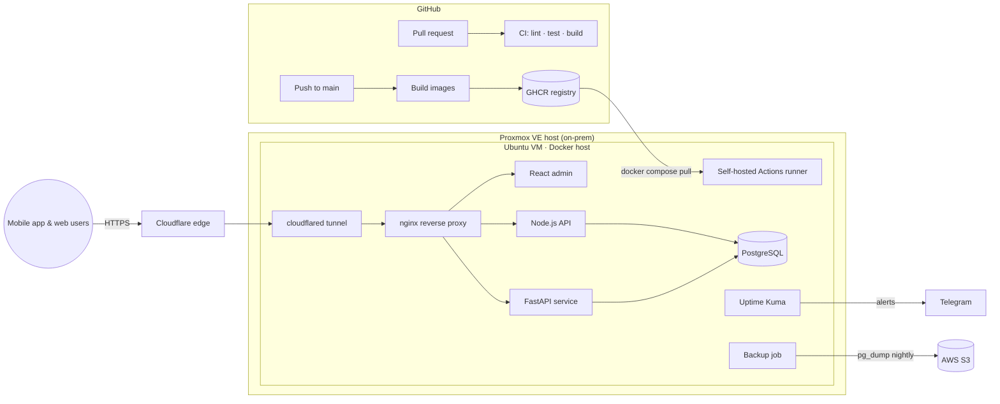
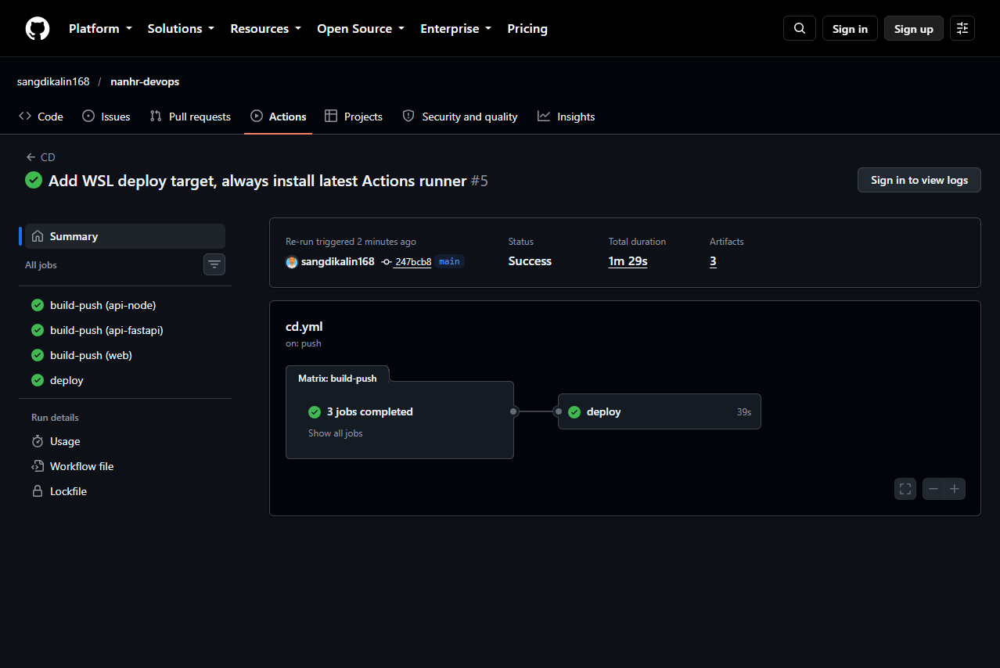
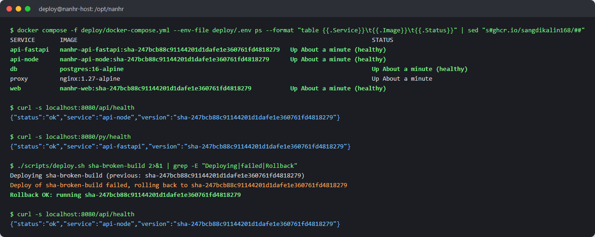

# NAN HR — Production Infrastructure (Proxmox · Docker · GitHub Actions)

A reference deployment pipeline modelled on **NAN HR**, a multi-company HR & attendance system that is
[live on the Apple App Store](https://apps.apple.com/search?term=NAN%20HR) and self-hosted on Proxmox.

> The application code of NAN HR is private. The services in `services/` are small stand-ins
> with the same shape (Node.js API, FastAPI service, React admin) so the whole pipeline can be
> cloned and run end to end.

**Verified end to end** on a Linux Docker host with a self-hosted runner: CI, image builds, deploy and
automatic rollback (see [Proof it works](#proof-it-works)). The Proxmox provisioning, Cloudflare Tunnel and
S3 backup pieces are included as scripts and config.

## Architecture



| Layer | Choice | Why |
|---|---|---|
| Virtualisation | Proxmox VE, one Ubuntu VM per environment | Snapshots before every risky change, cheap on-prem hosting |
| Containers | Docker + Compose, multi-stage images, non-root users | Small images, same artefact in CI and prod |
| Public access | Cloudflare Tunnel | HTTPS + DDoS protection with **zero inbound ports** opened on the home/office network |
| CI | GitHub Actions (hosted runners) | Lint, test and build every service on each PR |
| CD | GitHub Actions **self-hosted runner** inside the VM | The runner pulls from GHCR, so the server never has to be reachable from the internet |
| Registry | GitHub Container Registry | Images tagged by commit SHA → one-command rollback |
| Backups | Nightly `pg_dump` → gzip → AWS S3, 14-day retention | Off-site copy, independent of Proxmox |
| Monitoring | Uptime Kuma + `/health` endpoints, Telegram alerts | Know about downtime before clients do |

## Proof it works

Push to `main` → tests → images to GHCR → self-hosted runner deploys:



Healthy stack, then a deliberately broken release that rolls back on its own:



## Repository layout

```
services/
  api-node/      Express API (+ node:test tests, Dockerfile)
  api-fastapi/   FastAPI service (+ pytest tests, Dockerfile)
  web/           React (Vite) admin, served by nginx (Dockerfile)
deploy/
  docker-compose.yml   full stack for the VM
  nginx/nginx.conf     reverse proxy, routes /api and /py
  .env.example         every variable the stack needs
scripts/
  backup-postgres.sh   nightly backup to S3
  deploy.sh            pull + up + health check (used by CD)
  rollback.sh          redeploy any previous image tag
infra/proxmox/
  create-vm.sh         cloud-init Ubuntu VM via `qm`
  bootstrap-vm.sh      Docker, runner, cron, cloudflared
.github/workflows/
  ci.yml               PR checks
  cd.yml               build → push → deploy on main
```

## Pipeline

1. **Pull request** → `ci.yml` runs Node tests, Python tests, and a production build of the React admin, then builds
   all three Docker images (not pushed).
2. **Merge to `main`** → `cd.yml` builds the images, tags them `sha-<commit>` and `latest`, pushes to GHCR.
3. The **deploy job** runs on the self-hosted runner inside the Proxmox VM: `scripts/deploy.sh` pulls the new tag,
   restarts the stack with `docker compose up -d`, and polls `/health`. If the health check fails it rolls back to the
   previous tag automatically.

## Run locally

```bash
cp deploy/.env.example deploy/.env      # edit passwords
docker compose -f deploy/docker-compose.yml up -d --build
curl http://localhost:8080/api/health   # Node API
curl http://localhost:8080/py/health    # FastAPI
open http://localhost:8080              # React admin
```

## Rollback

```bash
./scripts/rollback.sh sha-1a2b3c4      # any tag from GHCR
```

## Provision a new environment on Proxmox

```bash
# on the Proxmox host
./infra/proxmox/create-vm.sh 120 nanhr-prod      # VMID, name
# inside the new VM
sudo ./infra/proxmox/bootstrap-vm.sh
```
